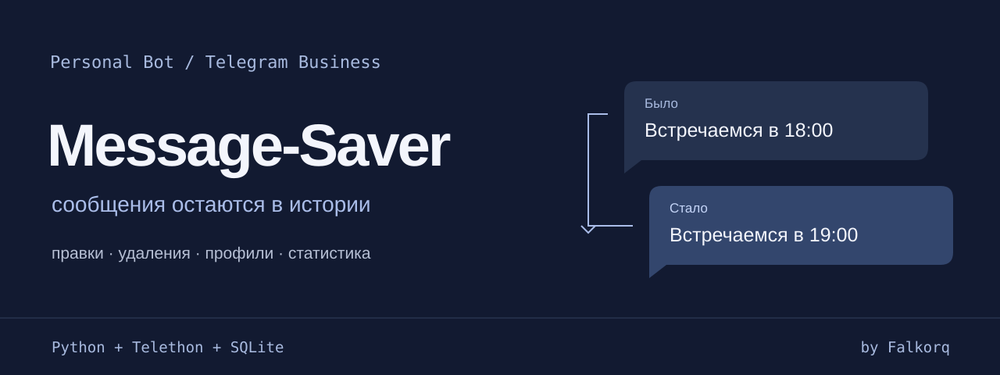

<p align="center">
  <strong>Сообщения · история правок · уведомления об удалениях · статистика</strong><br>
  Telegram Business · Python · SQLite · Mini App
</p>

<p align="center">
  <a href="#первый-запуск">Первый запуск</a> ·
  <a href="USER_GUIDE.md">Руководство пользователя</a> ·
  <a href="docs/PTERODACTYL_UPDATE.md">Обновление на хостинге</a> ·
  <a href="docs/PRIVACY.md">Данные и приватность</a>
</p>

# Nyan message

Бот для Telegram Business: сохраняет полученные сообщения, показывает изменения текста и присылает уведомления об удалениях. В Mini App можно посмотреть активность, найти чат и сравнить статистику за разные периоды.

Доступ выдаёт владелец по Telegram ID. Приглашённый пользователь управляет своими уведомлениями, сбором и удалением данных через личный чат с ботом. Основная часть работает без пользовательской MTProto-сессии.

> **Статус: подготовка к выпуску по приглашениям.** Перед публичным запуском оператору нужно подтвердить защиту хранилища и резервных копий, настроить поддержку и проверить восстановление на сервере. Порядок проверки: [эксплуатация и ограничения](docs/RELEASE_OPERATIONS.md).

## Возможности

| | Что доступно |
| --- | --- |
| **История сообщений** | Полученные Business-сообщения, прежний и новый текст при правке, уведомления об удалениях |
| **Статистика** | Активность по периодам, медиа, слова, ответы, инициатива и рейтинги чатов |
| **Mini App** | Поиск, сортировка, избранное, закрепления, графики и загрузка списка страницами |
| **Уведомления** | Настройки своих и чужих сообщений, правок и удалений; отдельная пауза доставки |
| **Управление данными** | Остановка и возобновление сбора, удаление собственных данных с подтверждением |
| **Доступ по приглашениям** | Выдача и отзыв доступа владельцем, проверка принадлежности аккаунтов и чатов |
| **Доставка** | Сохранение входящих событий и очереди уведомлений, повтор временных ошибок, учёт ограничений Telegram |

При автоматическом сборе бот видит только разрешённые ему Business-чаты и события, которые Telegram передал после подключения. Восстановить несохранённое сообщение нельзя. В уведомлении об удалении указан исходный автор: Telegram не сообщает, кто удалил сообщение.

В Mini App режим **Все аккаунты** объединяет статистику одного собеседника по Telegram ID в общую карточку по доступным пользователю аккаунтам. Фильтр по аккаунту сохраняет отдельные диалоги. Уже сохранённые данные и экспорты объединяются при просмотре, без перезаписи истории; время ответа рассчитывается внутри каждого диалога.

Мониторинг профилей через MTProto доступен отдельной закрытой группе. Обычное приглашение этот доступ не открывает. Создание правил автоудаления отключено; сохранённые правила приостановлены и доступны для удаления через `/mutelist`.

## Первый запуск

Нужны **Python 3.10+**, токен от [BotFather](https://t.me/BotFather) и Telegram-аккаунт с возможностью подключить Business-бота. Для Mini App потребуется HTTPS.

### 1. Установите код и зависимости

```sh
git clone https://github.com/Falkorq/Message-Saver.git
cd Message-Saver
python -m venv .venv
```

**Windows PowerShell:**

```powershell
.\.venv\Scripts\Activate.ps1
python -m pip install -r requirements.txt
Copy-Item .env.example .env
```

**Linux / macOS:**

```sh
source .venv/bin/activate
python -m pip install -r requirements.txt
cp .env.example .env
```

Копируйте `.env.example` только при первой установке, когда рабочего `.env` ещё нет.

### 2. Заполните `.env`

| Переменная | Значение |
| --- | --- |
| `BOT_TOKEN` | Токен вашего бота |
| `MY_CHAT_ID` | Telegram ID получателя уведомлений |
| `MY_ACCOUNT_IDS` | ID подключаемых аккаунтов через запятую |
| `MESSAGE_ENCRYPTION_KEY` | Ключ хранения; при первой установке создайте командой ниже |
| `BOT_USERNAME` | Username бота для переходов из Mini App |
| `SUPPORT_CONTACT` | Контакт поддержки, по умолчанию `@nyaaa_moe` |

Остальные параметры находятся в [`.env.example`](.env.example). Настройка HTTPS и адреса Mini App описана в [отдельной инструкции](docs/MINI_APP.md).

### 3. Создайте ключ и запустите бот

Для **новой установки**:

```sh
python generate_encryption_key.py
python app.py
```

Генератор записывает ключ в `.env` и не выводит его в консоль. При обновлении сохраняйте существующий ключ: без него нельзя прочитать зашифрованные сообщения и резервные копии. SQLite-базу приложение создаёт при запуске.

### 4. Подключите Telegram Business

Откройте личный чат с ботом, отправьте `/start` и следуйте `/connect`. После подключения проверьте `/status`. Для проверки уведомлений попросите собеседника отправить, изменить и удалить тестовое сообщение в разрешённом чате. Свои правки и удаления по умолчанию не вызывают уведомлений; включить их можно в `/notifications`. Через `/menu` можно открыть настройки и статистику. Старую переписку можно добавить в статистику через **Mini App → Ещё → Импорт старой переписки**: один JSON-экспорт личного чата до 128 МБ, с предпросмотром и защитой от повторного подсчёта. Медиа загружать не нужно; тексты в архив сообщений бота не добавляются.

Полная настройка сервера, дополнительных получателей и закрытых функций: [docs/SETUP.md](docs/SETUP.md).

## Управление в Telegram

| Команда | Назначение |
| --- | --- |
| `/menu` | Главное меню |
| `/connect` | Инструкция подключения Business-аккаунта |
| `/status` | Состояние подключения и сбора |
| `/chatstats` | Открыть статистику и Mini App |
| `/notifications` | Выбрать уведомления или поставить доставку на паузу |
| `/data` | Остановить сбор, возобновить его или удалить свои данные |
| `/id` | Узнать свой Telegram ID |
| `/help`, `/privacy` | Помощь и сведения о хранении данных |

Владелец управляет приглашениями через `/grant`, `/access` и `/revoke`. Пауза уведомлений оставляет сбор включённым; остановка сбора находится в `/data`. Команды внутри Business-чатов не выполняются.

Совместимые команды, закрытые профили и сценарии удаления описаны в [руководстве пользователя](USER_GUIDE.md).

## Обновление на хостинге

1. Остановите бот и сохраните резервную копию по инструкции.
2. Обновите код и зависимости, сохранив рабочие `.env`, ключ, базу, профильные данные и `erasure-guard.aes`.
3. Укажите `app.py` как файл запуска и проверьте подключение, статистику и доставку уведомлений.

Пошаговая инструкция для **Pterodactyl / NimarkoHost**, резервирование и восстановление: [docs/PTERODACTYL_UPDATE.md](docs/PTERODACTYL_UPDATE.md). При переходе с прежней версии следуйте процедуре миграции из этой инструкции.

## Хранение и ограничения

Тексты сообщений и входящие конверты хранятся с шифрованием AES-GCM. Часть метаданных, агрегатов статистики, слов и профильных данных остаётся открытой в SQLite или файлах. Оператору нужно отдельно обеспечить защиту диска, временных файлов и резервных копий, а также ограничить доступ к ключу.

По умолчанию срок хранения сообщений составляет **90 дней** (`RETENTION_DAYS`). Сроки хранения очередей, кэшей и других данных перечислены в [документе по эксплуатации](docs/RELEASE_OPERATIONS.md). Владелец сервера имеет технический доступ к данным.

После удаления данных для восстановления старой копии требуется актуальный журнал `erasure-guard.aes`. Telegram может повторно получить уведомление при сбое между отправкой и записью результата; гарантии доставки ровно один раз нет.

`.env`, рабочие базы, сессии Telegram, локальные фотографии и резервные копии исключены из Git. Публикуйте только `.env.example` с заглушками.

## Устройство проекта

| Путь | Назначение |
| --- | --- |
| `app.py` | Запуск, обработка Business-событий и доставка уведомлений |
| `public_ui.py` | Меню, подключение, настройки и управление данными |
| `reliable.py` | Сохранение входящих событий, транзакции и ограничения доставки |
| `product_state.py`, `erasure_guard.py` | Состояние сбора и журнал удалений |
| `business_tools/` | Статистика, HTTP API, Mini App и аватарки |
| `profile_monitor/` | Закрытый мониторинг профилей через Telethon |
| `storage_admin.py` | Зашифрованные резервные копии и восстановление |
| `tests/` | Проверки доступа, очередей, данных, API и интерфейса |

Стек: **pyTelegramBotAPI · Telethon · aiohttp · cryptography · SQLite**.

В активированном окружении с установленными зависимостями:

```sh
python -m unittest discover -s tests
```

Для браузерных проверок нужны дополнительные инструменты; порядок и границы локальной проверки описаны в [документе по эксплуатации](docs/RELEASE_OPERATIONS.md).

## Документация

| Инструкция | Содержание |
| --- | --- |
| [Руководство пользователя](USER_GUIDE.md) | Подключение, меню, уведомления и данные |
| [Настройка](docs/SETUP.md) | Параметры и запуск сервера |
| [Mini App](docs/MINI_APP.md) | HTTPS, веб-интерфейс и Telegram |
| [Обновление на хостинге](docs/PTERODACTYL_UPDATE.md) | Загрузка кода, миграции, резервирование и восстановление |
| [Эксплуатация](docs/RELEASE_OPERATIONS.md) | Очереди, сроки, диагностика и проверки перед выпуском |
| [Приватность](docs/PRIVACY.md) | Какие данные сохраняются и как их удалить |
| [Шифрование](docs/MESSAGE_ENCRYPTION.md) | Ключ и переход с прежнего хранения |
| [Доступ к MTProto](docs/MTPROTO_ACCESS.md) | Ограничения пользовательской сессии |
| [Баннеры разделов](docs/BANNERS.md) | Картинки меню и их замена |
| [Публичная справка](docs/PUBLIC_PAGES.md) | Помощь, данные и условия на поддомене статистики |

## Контакты

- Поддержка: [@nyaaa_moe](https://t.me/nyaaa_moe).
- Новости и обновления: [канал проекта @nyanPJ](https://t.me/nyanPJ).

## Резервные копии в личку

Чтобы получать зашифрованную копию базы раз в сутки, добавьте в серверный `.env`
`BACKUP_CHAT_ID=ваш_числовой_Telegram_ID`, заранее напишите боту `/start` и
перезапустите его. Без этой настройки отправка отключена. Указывайте только
доверенного оператора: копия содержит базу всех пользователей, а не одного аккаунта.
Первая отправка — примерно через минуту после запуска; после успешной доставки
следующая — через 24 часа, время сохраняется между перезапусками. После ошибки
бот повторяет попытку через час; причина без секретов появляется в консоли.

В ZIP входят только `database.sqlite3.aes` и `erasure-guard.aes`.
`.env`, токен, ключ, MTProto-сессия, фотографии и исходники не отправляются.
Это резервная копия базы, а не всего сервера. Сохраните текущий
`MESSAGE_ENCRYPTION_KEY` отдельно вне сервера: без него восстановление невозможно.
Копии в Telegram не удаляются автоматически; их срок хранения контролирует оператор.
После удаления пользовательских данных для восстановления нужен самый свежий
журнал удалений, а не только журнал внутри старого архива.

Большой ZIP отправляется частями до 45 МиБ и отдельным `*.manifest.json` с
порядком частей, размерами и SHA-256. Скачайте все файлы одной отправки в одну папку.
Одиночный ZIP можно сразу распаковать; разделённый сначала соберите:

```text
python offsite_backup.py --manifest путь/имя.zip.manifest.json --target recovered.zip
```

Распакуйте ZIP и восстановите базу в новый файл с ключом и актуальным журналом:

```text
python storage_admin.py restore --source database.sqlite3.aes --target restored.sqlite3 --ledger erasure-guard.aes
```

Команда не перезаписывает существующую базу и помещает восстановленную в карантин.
Дальнейшие действия описаны в `docs/PTERODACTYL_UPDATE.md`.

---

Nyan message · [Falkorq](https://github.com/Falkorq)
